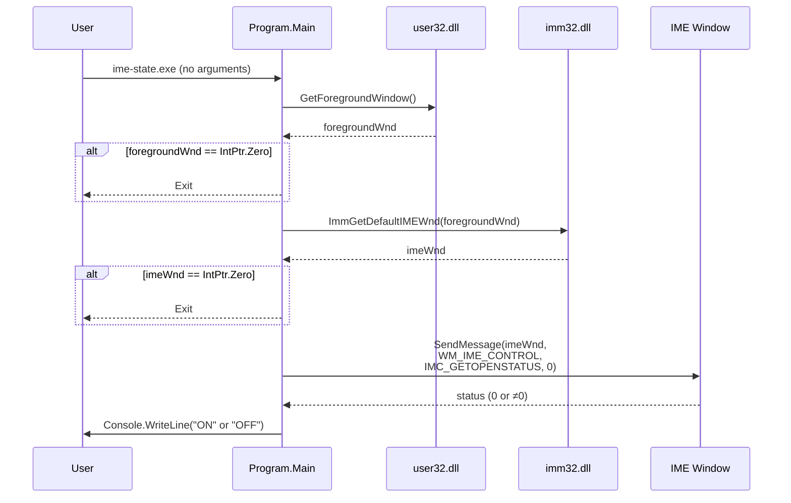
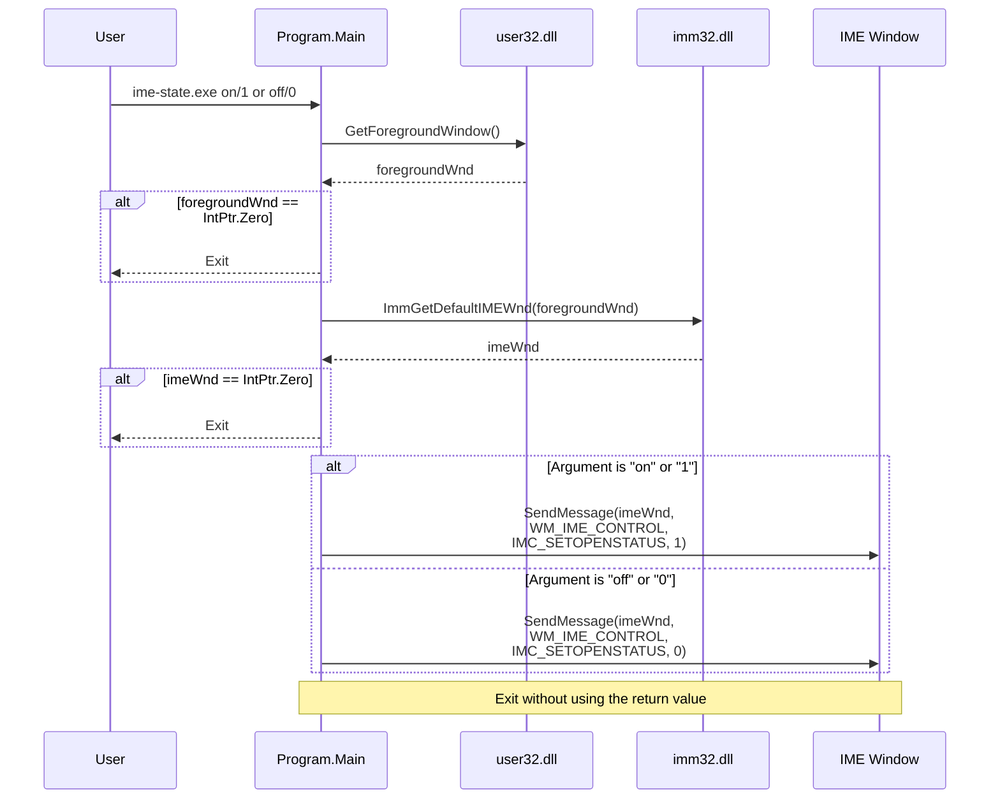

# ime-state

A tiny Windows CLI tool to get or set the IME state of the foreground window.

## Usage

| Command                   | Description                                   |
| :------------------------ | :-------------------------------------------- |
| `ime-state.exe`           | Prints the current IME state (`ON` or `OFF`). |
| `ime-state.exe on` / `1`  | Turns the IME on.                             |
| `ime-state.exe off` / `0` | Turns the IME off.                            |

## Sequence Diagrams

- Get IME State: `ime-state.exe`

- Set IME State: `ime-state.exe on/1 or off/0`

## Build & Release

- **Build:** Run `build.bat` to output `ime-state.exe` to the `bin/` directory.
- **Release:** Run `release.bat` to package the executable and `LICENSE` into `release/ime-state.zip`.

## Requirements

- Windows
- .NET Framework 4.0 or later

## License

See the [LICENSE](LICENSE) file.
